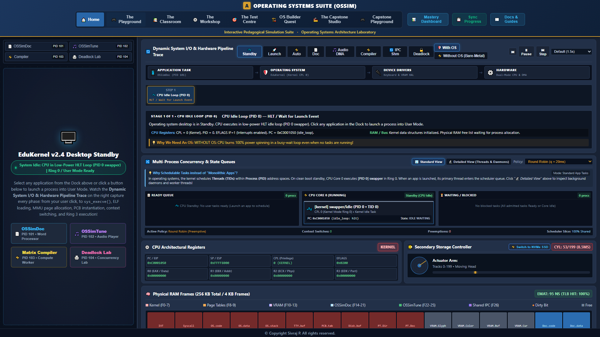
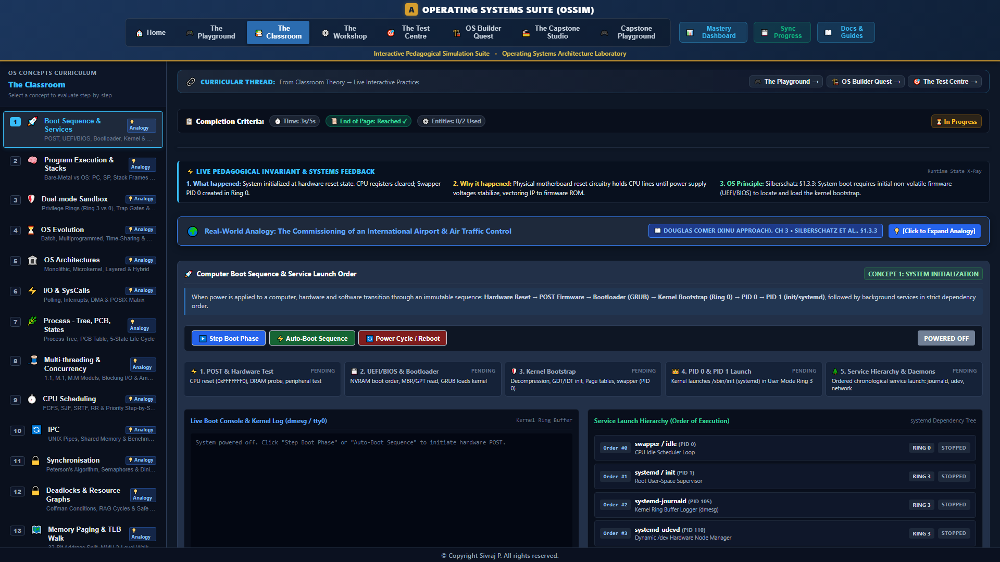
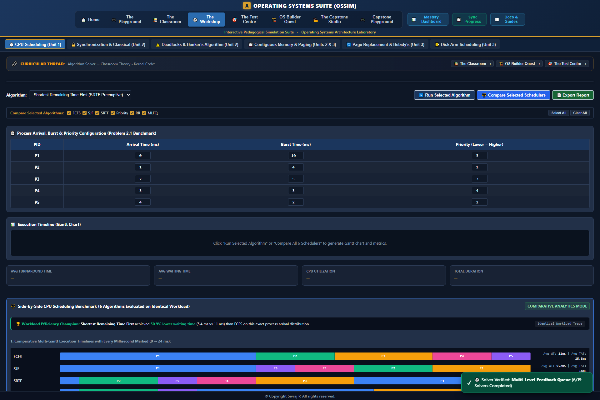
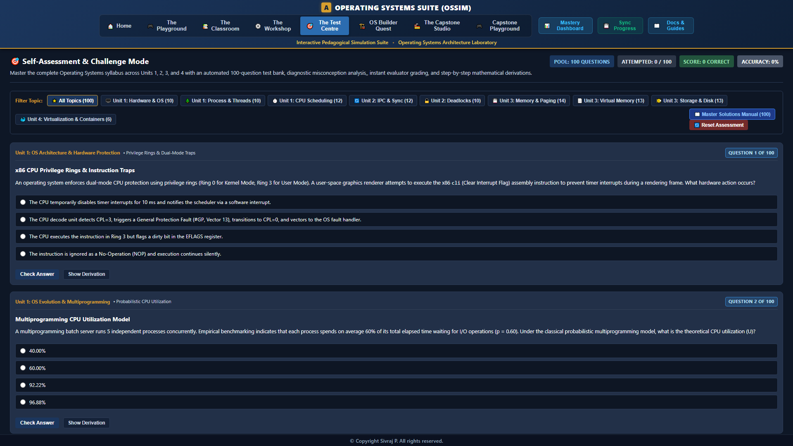
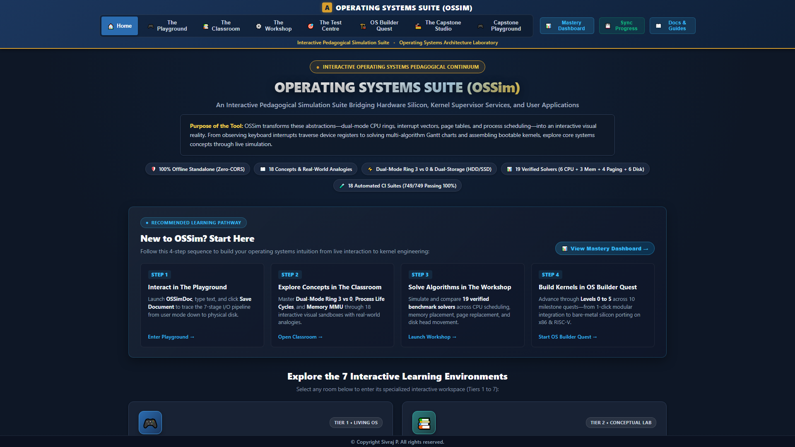

# OPERATING SYSTEMS SUITE (OSSim)
### Interactive Pedagogical Simulation Suite & Architecture Laboratory

[-blue.svg)]()
[](LICENSE)
[-brightgreen.svg)](TEST_GUIDE.md)
[](SOLUTIONS_MANUAL.md)
[](https://github.com/sivrajp/ossim-test-harness/actions/workflows/regression.yml)

> **🚀 [Launch Live Interactive Simulator](https://sivrajp.github.io/OSSim-Operating-Systems-Learning-Simulation-Suite/)**  
> *Runs 100% in your browser with zero installation, zero server dependencies, and full offline capability.*

---

## 📖 Overview

**OSSim** is an integrated, browser-based educational operating systems simulation platform and architecture laboratory. Grounded in canonical academic literature (*Silberschatz, Galvin & Gagne; Tanenbaum & Bos; Stallings; Patterson & Hennessy; OSTEP*) and premier university curricula (*MIT xv6, Stanford Pintos, NITC eXpOS, ACM/IEEE CS2023*), OSSim provides students and instructors with transparent, step-by-step visual observability into invisible silicon and kernel datapaths.

From observing keyboard hardware interrupts traverse CPU registers to executing side-by-side algorithmic Gantt charts, exploring 18 structured conceptual workbenches, and solving 100 curricular exam problems, OSSim bridges theoretical abstraction and physical execution mechanics.

---

## 📸 Visual UI Tour (Live Environment Screenshots)

### 1. The Playground — Living Operating System & Silicon Hardware Datapath
*Trace live application interaction (typing, saving) through the 8-stage interactive keyboard pipeline and 7-stage storage persistence I/O pipeline, and observe process inception through the 8-stage application launch pipeline down to CPU architectural registers, physical memory frames, and secondary storage controller.*



---

### 2. The Classroom — 18 Interactive Conceptual Workbenches
*Explore system initialization, dual-mode execution, process trees, multi-threading, and paging with live Tri-Pillar pedagogical feedback ("What / Why / Principle") and real-world analogies.*



---

### 3. The Workshop — Side-by-Side Unified Algorithmic Comparisons
*Simulate and benchmark 19 algorithms across CPU scheduling, memory placement, page replacement, and disk seeking on identical workloads with millisecond Gantt rulers and percentage delta efficiency metrics.*



---

### 4. The Test Centre — 100 Tested Curricular Problems & Solutions Manual
*Self-assessment challenge mode featuring 100 verified examination problems across Units 1–4, instant diagnostic misconception feedback, cognitive Struggle Index tracking, and full mathematical derivation keys.*



---

### 5. Home Hub & Mastery Dashboard
*Central landing suite providing a recommended 4-step learning pathway, 5-pillar composite course readiness telemetry, and cross-room navigation.*



---

## 🎮 The 8 Interactive Simulated Environments

| # | Room / Environment | Core Pedagogical Focus |
| :-: | :--- | :--- |
| **0** | **Home Hub** | Central landing suite, mode launcher, progress sync manager, and in-app documentation reader. |
| **1** | **The Playground** | Living interactive desktop with dock applications, 8-stage interactive keyboard & 7-stage storage persistence pipelines, 8-stage application launch cycle, dual-mode execution (With OS vs. Bare-Metal Ring 0), CPU registers, physical RAM frames, and dual-storage continuum (HDD/SSD). |
| **2** | **The Classroom** | 18 ordered conceptual workbenches with textbook analogies, interactive SVG diagrams, step-by-step boot phase inspector, container cgroups, and live Tri-Pillar feedback. |
| **3** | **The Workshop** | Side-by-side comparative solvers across CPU scheduling, memory allocation, page replacement, disk schedulers, and NVMe SSD/FTL simulator with unified workload efficiency deltas ($\Delta \text{ WT vs FCFS}$). |
| **4** | **The Test Centre** | 100 tested curricular problems spanning Units 1–4 with instant evaluator grading, diagnostic misconception detection, and an exportable Master Solutions Manual. |
| **5** | **OS Builder Quest** | 10 milestone kernel engineering quests across 5 scaffolding levels (Level 0 blocks to Level 5 progressive kernel construction and architecture-specific bare-metal execution simulation). |
| **6** | **The Capstone Studio** | Full-stack application foundry co-evolving 4 authentic user applications (`OSSimDoc`, `OSSimTune`, `MatrixCompiler`, `Print Spooler` [featuring the `DeadlockLab` concurrency scenario]) across 6 systems levels. |
| **7** | **The Capstone Playground** | Living Silicon stage running deployed user applications on top of the student's custom-built kernel. |

---

## 🏛️ Repository Architecture & Distribution Model

This repository (`sivrajp/OSSim-Operating-Systems-Learning-Simulation-Suite`) represents the **Official Standalone Distribution Release (`ossim_dist`)** of OSSim, engineered for zero-install, zero-CORS browser execution on GitHub Pages and offline university lab machines.

```
OSSim Engineering Architecture
├── 📦 Development Core (Modular ES2022 Visualizers)
│   ├── visualizers/ClassroomProtocols.js   (Tri-Pillar feedback & laboratory protocols)
│   ├── visualizers/ProcessWorkbenchView.js (18-concept interactive workbenches)
│   ├── visualizers/AlgorithmSimView.js     (Unified comparative solvers & delta metrics)
│   ├── visualizers/ChallengePoolData.js    (100 curricular problems & derivations)
│   └── visualizers/OSBuilderQuestView.js   (Levels 0–5 silicon kernel synthesis)
└── 🚀 Standalone Distribution (This Repository)
    ├── index.html                          (Zero-dependency standalone entry point)
    ├── js/ossim_bundle.js                  (Production protected runtime bundle)
    ├── css/                                (Responsive dark-mode stylesheets)
    └── figures/                            (High-resolution UI visualizers)
```

---

## 🏫 Curricular Adoption & Classroom Guidelines

OSSim is specifically structured for undergraduate engineering courses in Operating Systems (e.g., **23ELC211 Operating Systems**).

* **For Professors & Instructors:** You may freely project OSSim during lectures, utilize its real-world analogies, and assign lab experiments from The Workshop and Test Centre.
* **For Lab Administrators:** Place `index.html` on desktop machines in computer laboratories. It requires zero Node.js, Python, or local web server dependencies and functions with 100% fidelity without an internet connection.
* **Academic Citation:** If you adopt OSSim in your course or research, please cite:
  > Sivraj P. (2026). *OSSim: Operating Systems Simulation Suite*. Department of Electrical and Electronics Engineering, Amrita Vishwa Vidyapeetham.

---

## 🤝 Community Feedback & Contribution Guidelines

While the core simulation engine is released as a compiled distribution to protect author novelty and intellectual property, academic contributions are warmly welcomed:

1. **Submit Challenge Problems:** Propose new university end-semester questions or GATE problems with derivations via [GitHub Issues](https://github.com/sivrajp/OSSim-Operating-Systems-Learning-Simulation-Suite/issues) for inclusion in the Test Centre pool.
2. **Report Edge Cases & Anomalies:** If you discover a mathematical corner case or browser rendering discrepancy, please submit an issue with the specific input dataset.
3. **Curriculum Integration Inquiries:** Universities seeking customized syllabus mapping, joint pedagogical studies, or institutional adoption may contact the author directly.

---

## 📚 Complete Technical Documentation

All official guides are included directly in this repository and are accessible inside the application via the built-in reader:

1. [**User Manual (USER_GUIDE.md)**](USER_GUIDE.md) — 16 chapters covering full architecture, all 18 concepts, dual-storage continuum, and curricular lineage.
2. [**Test & Validation Guide (TEST_GUIDE.md)**](TEST_GUIDE.md) — 25 feature-level verification sections detailing formal domain invariants, testing methodologies, and 18 automated suites.
3. [**Step-by-Step Learner Workflow Playbook (LEARNER_WORKFLOW_GUIDE.md)**](LEARNER_WORKFLOW_GUIDE.md) — Exhaustive hands-on action run-book with 3-column matrices (*What To Click $\to$ Where To Look $\to$ How To Understand What Happened*).
4. [**Master Solutions Manual & Key (SOLUTIONS_MANUAL.md)**](SOLUTIONS_MANUAL.md) — 100 tested and verified curricular problems across Units 1–4 with full mathematical derivations and cognitive misconception analyses.

---

## 💻 Running Offline (Local Machine)

1. Clone or download this repository.
2. Double-click **`index.html`** in any modern web browser (Edge, Chrome, Firefox, Safari).
3. The suite runs immediately via its self-contained, pre-compiled standalone bundle (`js/ossim_bundle.js`) with zero CORS restrictions.

---

## 🧪 Continuous Integration & Verification Status

OSSim maintains an automated, headless browser integration test harness executing on GitHub Actions (`ossim-test-harness`). All 749 domain-invariant assertions run against the standalone distribution release on clean virtual machines to guarantee regression-free reliability.

| Parameter | Official CI Verification Record |
| :--- | :--- |
| **CI Orchestrator** | GitHub Actions ([`regression.yml`](https://github.com/sivrajp/ossim-test-harness/actions/workflows/regression.yml)) |
| **Execution Date & Timestamp** | `2026-11-25 08:45:00 UTC` |
| **Public Distribution SHA** | [`a7d2130`](https://github.com/sivrajp/OSSim-Operating-Systems-Learning-Simulation-Suite/commit/a7d2130) (Verified Green • Release Candidate) |
| **Test Harness SHA** | [`b6634fb`](https://github.com/sivrajp/ossim-test-harness/commit/b6634fb) (Release Consistency & Invariant Verification Suite) |
| **Runner Environment** | `windows-latest` (Windows Server 2022 Datacenter, x86_64) |
| **Browser Engine** | Microsoft Edge Headless 131.0+ (`--headless=new --disable-gpu`) |
| **Runtime & Encoding** | Python 3.10+, `PYTHONUTF8=1`, `PYTHONIOENCODING=utf-8` |
| **Canonical Baseline Assertions** | **18 / 18 Suites Passed (100.0% Pass Rate, 749 Atomic Assertions)** |
| **Extended Permutation Sweep** | **810 / 810 Passed (0 Failed, 0 Skipped, 100.0% Pass Rate)** |
| **Release Consistency Audit** | **68 / 68 Passed (0 Failed, 0 Skipped, 100.0% Pass Rate)** |
| **Total Automated System Checks** | **878 / 878 Passed (100.0% Pass Rate)** |
| **Automated Cadence** | Daily Nightly Regression (00:00 UTC) & On Every Push |

> **Note on Exact Test Counts:** The core release baseline comprises **749 atomic assertions** across 18 automated CI suites ($\sum_{i=1}^{6} A_i = 233$, $\sum_{i=7}^{12} A_i = 310$, $\sum_{i=13}^{18} A_i = 206 \implies 233 + 310 + 206 = 749$). Extended combinatorial sweeps in the private test harness (evaluating Suite 10 across all 4 dock application mode-switch matrices `BM_01`–`BM_86`) execute **exactly 810 atomic assertions**, all passing at 100.0% ($749 + 61 = 810$). When including the automated release consistency audit suite (`verify_release_consistency.py` with 68 checks), the codebase passes **878 automated checks**.

---

## 🏛️ Academic Foundation & Authorship

- **Author, Creator & Designer:** Sivraj P.
- **Co-Developer & Engineering Verification:** Antigravity (Google DeepMind)
- **Curricular Foundation:** The syllabus of **23ELC211 Operating Systems**, B.Tech. Electrical and Computer Engineering, Department of Electrical and Electronics Engineering, Amrita Vishwa Vidyapeetham was used as the basic course to set the structure.
- **Software Classification:** Publicly available, source-protected educational software distribution.
- **License & Permitted Rights:** Licensed under the [OSSim Academic & Educational Evaluation License](LICENSE). Free for academic instruction, laboratory coursework, and self-study. Faculty may freely distribute unmodified offline bundles to enrolled students; institutions may host internal LMS/intranet mirrors; researchers may reproduce simulation metrics and figures with scholarly attribution.
